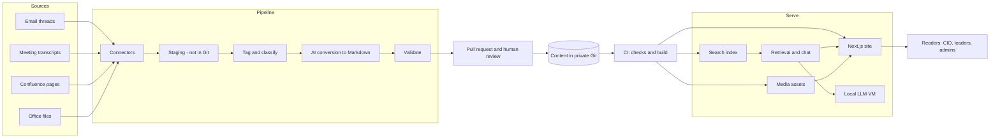

# 3. Architecture

## System context

Readers use a web portal. The portal is built from Markdown in Git. A pipeline keeps that Markdown current from the organization's source systems. A local LLM answers questions. Derived media (video, audio, quizzes, game scenarios) are generated from pages and stored alongside them.

Nothing leaves the corporate network. Nothing in the portal talks to vCenter or any live infrastructure API.

## Components

| Component | Responsibility | Technology | Status |
| --- | --- | --- | --- |
| Connectors | Pull raw artifacts from sources on a schedule or by webhook | Python or Node services, source APIs | Proposed |
| Staging | Hold raw payloads and source metadata. Never committed | Local volume or object store | Proposed |
| Tagging | Assign domain, priority, audience, access scope | Admin input plus rules | Spec |
| AI conversion | Turn raw text into validated Markdown | Local LLM, prompt templates, JSON Schema | Spec, Addendum |
| Review | Human approval of AI drafts | Pull requests | Addendum |
| Content store | Source of truth | Markdown and YAML front matter in private Git | Spec |
| CI/CD | Validate, build, deploy | Organization's CI system | Open (D-017) |
| Site | Pages, navigation, executive views, mode entry points | Next.js App Router, Tailwind CSS | Spec |
| Search | Full-text search | Pagefind to start; Meilisearch or Typesense if scope filtering is needed | Proposed |
| Assistant | Retrieval plus prompt building plus streaming | Next.js route handler | Proposed |
| LLM VM | Serve the chat model and the embedding model | llama.cpp `llama-server`, CPU-only | Proposed |
| Media | Store and serve video, audio, quiz and game assets | Static files plus manifests | Proposed |
| Identity | Authenticate users and supply groups | OIDC or SAML provider federated to Active Directory | Spec |

## Overview diagram



Reading the diagram: sources flow left to right through the pipeline into a pull request. A merge lands the Markdown in Git. CI builds the site, the search index and the media manifests. The site is what readers use. Retrieval reads the index and calls the LLM VM. Everything after the pull request is automated. Everything before the merge ends with a person.

## Mapping to the original four stages

| Stage | Name | Where it lives | Output |
| --- | --- | --- | --- |
| 01 | Extraction and ingestion | `pipeline/connectors` | Raw payload, source metadata |
| 02 | Metadata and taxonomy | `pipeline` tagging step, admin input | Taxonomy schema, access scope |
| 03 | Structured conversion | `pipeline/convert` | Normalized `.md` files, generated diagrams |
| 04 | Site generation | `site` and CI | Internal web portal |

## Interfaces between components

These contracts keep the components decoupled (N4).

| Interface | Contract |
| --- | --- |
| Pipeline to Git | A pull request that adds or changes Markdown. The front matter schema in [content model](04-content-model.md) is the contract |
| Git to CI | A merge to `main` fires a webhook |
| CI to site | `content/` is read at build time. No headless CMS |
| CI to search | One JSON record per page: title, headings, body, domain, doc type, audience, access scope, last ingested |
| Site to assistant | `POST /api/ask` with the question. Response is streamed text plus source links |
| Assistant to LLM | OpenAI-compatible HTTP API on the LLM VM, streaming on |
| Page to derived asset | An asset manifest holds the page ID and the content hash it was built from |

## What is static and what is dynamic

- **Static:** document pages, domain indexes, executive views (built from content).
- **Dynamic:** authentication and authorization checks, navigation filtering, server-side search (if used), Ask.

Static generation gives the sub-second loads in N3. Access control cannot be baked into static HTML, because the HTML is the same for every viewer. Authorization therefore runs at request time in middleware or in a reverse proxy. See [security](09-security-and-governance.md).

## Technology choices

| Decision | Choice | Alternatives considered | Why |
| --- | --- | --- | --- |
| Frontend | Next.js App Router, Tailwind CSS | Static site generators such as Astro or Docusaurus | Matches the web approach used in isvara.io. Middleware and route handlers cover auth and Ask |
| Content layer | Markdown from Git at build time | Headless CMS | Keeps the audit trail in Git. Fewer moving parts |
| Diagrams | Mermaid in Markdown | Image files only | Text diffs, reviewable, rendered client-side. Hand-drawn diagrams can be added as SVG with their source (D-022) |
| Search | Pagefind first | Meilisearch, Typesense, OpenSearch | No extra service in the lab phase. Move to a server if scope filtering is needed |
| Inference | llama.cpp `llama-server` | Ollama, vLLM CPU build | Runs on CPU, OpenAI-compatible, simple to operate |
| Hosting | On-premises VM with Docker Compose first; Kubernetes if one exists | Public cloud, Vercel | N1 |
| Rebuild trigger | Git webhook plus nightly cron | Cron only | Content appears minutes after approval |

## Repository layout and the content boundary

This repository holds code, documentation and **synthetic sample content**. Production content is private and lives in an internal Git repository (D-027). In production, `content/` is that repository, attached at build time as a Git submodule or a checkout step. The schema, linter and CI definitions live here and apply to both.

```text
content/      Markdown. Sample content here. Production content in the internal repository.
pipeline/     Ingestion and AI conversion.
site/         Next.js portal.
assistant/    Retrieval and LLM serving configuration.
media/        Derived video, audio, quiz and game assets, with manifests.
docs/         This documentation.
config/       Access-scope mapping, taxonomy, connector settings (no secrets).
```

## Key trade-offs

- **Static pages versus per-user content.** Static is fast and simple. It forces navigation and search to be filtered separately from the pages. See DC-05 in [design considerations](12-design-considerations.md).
- **Local LLM versus hosted API.** Local keeps data inside the network (N1). It limits model size, speed and concurrency. See [assistant and LLM](08-assistant-and-llm.md).
- **Human review versus freshness.** The pull-request gate slows publication. It is the main defence against wrong AI output.
