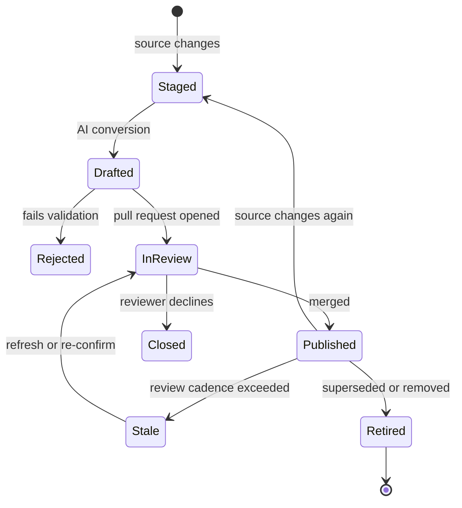

# 4. Content model

Markdown files with YAML front matter are the source of truth. Every other artifact (pages, search records, answers, video, audio, quizzes, game scenarios) derives from them.

## Domains

Content folders match the six deliverable domains from the original strategy, plus four operational domains (Proposed) that a private-cloud site also needs: team structure, runbooks, operations, and decisions.

| Domain folder | Contents |
| --- | --- |
| `infrastructure-architecture` | Logical and physical design, C4 views, TOGAF viewpoints |
| `connectivity-diagrams` | Network, storage and management connectivity |
| `security` | Baselines, hardening, compliance mapping |
| `sops` | Standard operating procedures |
| `user-guides` | Guides for consumers of the private cloud |
| `install-upgrade` | Installation and upgrade procedures |
| `team-structure` | Teams, roles, responsibilities (RACI), on-call and escalation paths (Proposed) |
| `runbooks` | Response to a specific alert, incident or failure (Proposed) |
| `operations` | Disaster recovery, business continuity, change management, maintenance windows, monitoring and alerting, capacity planning (Proposed) |
| `decisions` | Architecture decision records (Proposed) |

The first six folders come from the strategy document. The last four are Proposed additions. Remove any your environment does not need.

## Document types

| `doc_type` | Purpose | Required sections |
| --- | --- | --- |
| `overview` | Executive summary of a domain or system | Summary, Context, Key decisions |
| `architecture` | C4 or TOGAF view | Context, Containers or components, Decisions, Risks, Related |
| `sop` | Repeatable operational procedure | Purpose, Prerequisites, Steps, Verification, Rollback |
| `guide` | How a consumer uses a service | Audience, Steps, Troubleshooting |
| `install-upgrade` | Install or upgrade runbook | Prerequisites, Steps, Verification, Rollback, Known issues |
| `security-baseline` | A control set and its status | Scope, Controls, Evidence, Exceptions |
| `decision` | An architecture decision record | Context, Decision, Alternatives, Consequences |
| `team` | A team or role: what it owns and how to reach it (Proposed) | Purpose, Responsibilities, Services owned, RACI, On-call and escalation, Contacts |
| `runbook` | Response to one alert, incident or failure (Proposed) | Trigger, Impact, Diagnosis, Actions, Escalation, Verification, Follow-up |
| `operations-plan` | A standing operational plan: DR, change, monitoring, capacity (Proposed) | Scope, Objectives, Roles, Procedure, Testing, Review |
| `service` | A service catalog entry for consumers (Proposed) | Description, Audience, How to request, Service levels, Support |

### Which type goes where

| `doc_type` | Usual domain |
| --- | --- |
| `overview` | Any domain |
| `architecture` | `infrastructure-architecture`, `connectivity-diagrams` |
| `sop` | `sops` |
| `guide`, `service` | `user-guides` |
| `install-upgrade` | `install-upgrade` |
| `security-baseline` | `security` |
| `decision` | `decisions` |
| `team` | `team-structure` |
| `runbook` | `runbooks` |
| `operations-plan` | `operations` |

### SOP or runbook

- An SOP is planned, routine work. It starts on a schedule or a request. Example: patch a host cluster, add a datastore.
- A runbook is unplanned work. It starts with an alert or a symptom. Example: datastore latency alarm, vCenter service down.
- A runbook can call an SOP for a step. It links to it. It does not copy it.

### Team pages and personal data

- Team pages name teams, roles, distribution lists, queues and on-call rotation names.
- They do not hold personal phone numbers, home details or other personal data. The policy scan applies.
- Where a person must be named, use the directory handle. The directory stays the source of truth for contact details.

The heading linter (see [deployment](10-deployment-and-cicd.md)) enforces the required sections per type. Section lists are Proposed and are tuned in Phase 0.

## Front matter schema

| Field | Type | Required | Notes |
| --- | --- | --- | --- |
| `title` | string | yes | Human title |
| `doc_type` | enum | yes | From the table above |
| `domain` | enum | yes | Must match the folder |
| `priority` | enum: `high`, `medium`, `low` | yes | Drives navigation order and review cadence |
| `audience` | list of enum: `executive`, `admin`, `engineer`, `security`, `all` | yes (Proposed) | Drives executive views and filters |
| `access_scope` | string | yes | Maps to AD groups in `config/access-scopes` |
| `sources` | list of `{type, id, version}` | yes | `type` is one of `confluence`, `email`, `transcript`, `office`, `manual` |
| `last_ingested` | ISO 8601 datetime | yes | Set by the pipeline |
| `origin` | enum: `human`, `ai-drafted`, `ai-drafted-human-edited` | yes (Proposed) | Shown on the page |
| `reviewed_by` | string | yes | Reviewer identity from the merge |
| `reviewed_on` | date | yes (Proposed) | Reviewer sign-off date |
| `owner` | string | yes (Proposed) | Team or person who answers for the page |
| `review_cadence_days` | integer | no (Proposed) | Default per `priority` |
| `related` | list of page IDs | no | Cross-links |
| `supersedes` | page ID | no | Replaced page |
| `modes` | object | no (Proposed) | Derived assets available for this page, written by CI |

Example:

```yaml
---
title: Management cluster design
doc_type: architecture
domain: infrastructure-architecture
priority: high
audience: [admin, engineer]
access_scope: platform-team
sources:
  - type: confluence
    id: "123456"
    version: 14
  - type: transcript
    id: "2026-04-02-design-review"
    version: 1
last_ingested: 2026-04-03T06:12:00Z
origin: ai-drafted-human-edited
reviewed_by: j.doe
reviewed_on: 2026-04-04
owner: platform-architecture
---
```

The example is illustrative. It uses invented values.

## Page identity

- The page ID is the path under `content/`, without the extension.
- IDs never change. A move leaves a redirect entry (Proposed).
- Derived assets reference the page ID plus a content hash.

## Source types and their mapping

| Source type | `sources[].id` | `sources[].version` |
| --- | --- | --- |
| `confluence` | Page ID | Page version number |
| `email` | Message-ID of the thread root | Count of messages |
| `transcript` | Meeting ID or file name | Revision |
| `office` | Path and file name | File modified time or hash |
| `manual` | Author handle | Revision |

## Taxonomy and access scope

- Admins define the taxonomy in `config/taxonomy.yaml`: domains, doc types, tags, audiences.
- `config/access-scopes.yaml` maps each `access_scope` value to one or more AD groups.
- An unknown scope fails validation. A missing scope fails validation. There is no default of "open".

## Conventions for content

- One H1, from the title. Headings in sentence case.
- Diagrams are Mermaid by default. Each diagram is followed by one or two sentences that say what it shows. This text is the accessible alternative.
- C4: context, container and component views each get their own diagram.
- TOGAF: business, data, application and technology architecture sections appear where relevant.
- Terms defined in the [glossary](glossary.md) are used consistently.
- No credentials, tokens, IP addresses of sensitive systems, or personal data. The policy scan enforces what it can.

## Lineage

- The page lists its sources, versions and `last_ingested` from front matter.
- The page history comes from `git log` at build time: who changed it, when, and the pull request.
- AI-drafted pages show the draft-to-merged diff when available (Proposed).

## Lifecycle



A page moves from `Published` to `Stale` when `reviewed_on` plus `review_cadence_days` has passed. Stale pages stay visible with a banner. They are not removed.

## Handling change

- A changed source creates a new draft, not an overwrite. A reviewer sees the diff against the published version.
- A reviewer's manual edits to an AI-drafted page must survive the next regeneration. The pipeline therefore proposes a diff against the current page. It does not replace the page. (Open: D-009)
- Removing a source does not delete the page. A reviewer decides.

## Derived assets

| Asset | Stored at | Manifest fields |
| --- | --- | --- |
| Video | `media/video/<page-id>.*` | `page_id`, `content_hash`, `generated_on`, `reviewed_by`, `captions`, `transcript` |
| Audio | `media/audio/<page-id>.*` | same as video |
| Quiz | `media/quizzes/<page-id>.json` | `page_id`, `content_hash`, `questions[]`, each with `source_heading` |
| Game scenario | `media/game/<scenario-id>.json` | `page_ids[]`, `content_hashes[]` |

CI compares each manifest's `content_hash` with the page's current hash. A mismatch marks the asset **out of date** on the page. It does not delete the asset.
