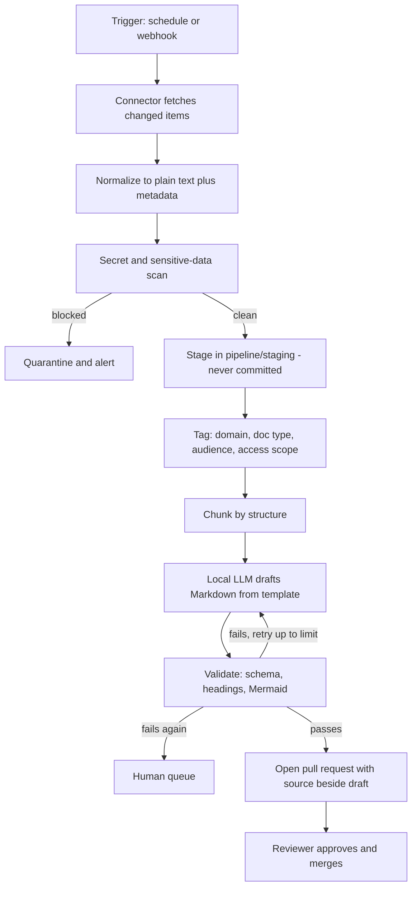

# 5. Ingestion and AI conversion

This is the original stages 01 to 03. It keeps the content current. It is not the point of the product (see [vision](01-vision-and-audiences.md)), but it must be reliable and safe.

## Flow

## 1. Connectors

All connectors use read-only service accounts (S5) and run on a schedule. Webhooks add speed where the source supports them.

| Source | Mechanism | Unit of change | Notes |
| --- | --- | --- | --- |
| Confluence | REST API, CQL query by space and last-modified; page body in storage format, converted to text | Page version | Follow attachments for diagrams. Respect page restrictions when setting `access_scope` |
| Email | IMAP or Microsoft Graph, read from a dedicated shared mailbox or label | Thread | Strip signatures, quoted replies and disclaimers. Keep sender roles, not personal data, where possible |
| Meeting transcripts | Zoom or Teams webhook on transcript ready, or fetch from recordings API | Meeting | Speaker labels kept. Filler removed. Decisions and action items extracted |
| Office files | Watcher on a designated share, or SharePoint via Graph | File version | Word to text with headings. Excel by sheet to tables. PowerPoint by slide with speaker notes |

Common connector behaviour:

- Idempotent. The same item and version is processed once.
- State store tracks `(source type, id, version)`.
- Back-off and retry on failure. A permanent failure raises an alert.
- Raw payloads go only to staging. Staging is excluded from Git (`.gitignore`) and has a retention limit (Proposed: 30 days).
- Each run logs counts only, not content.

## 2. Pre-AI safety scan (S4)

- Detect credentials, keys, tokens, and private key blocks.
- Detect configured sensitive patterns, for example internal classification markings (set in `config/policy`).
- On a hit: quarantine the item, alert the data owner, do not send it to the LLM, do not stage it.
- The scan runs again on the generated Markdown before the pull request opens.

## 3. Tagging

- Admin rules in `config/taxonomy.yaml` assign domain, audience and priority from source attributes: Confluence space, mailbox label, file location, meeting series.
- A classifier step may suggest values where rules do not match. Suggestions are labelled as such in the pull request.
- Access scope comes from the source's own restriction where known. It defaults to the most restrictive configured scope, never to open.

## 4. Chunking

- Chunk by document structure, not fixed size: headings, slides, sheets, message boundaries.
- Keep a heading path with each chunk so the model sees where text sits.
- Target chunk size fits comfortably in the local model's working context. Longer sources are processed in sections and then merged by a final pass.

## 5. AI conversion

### Model hosting

A hosted API is likely disqualified by N1. The conversion step therefore uses a self-hosted open-weight model. It can share the LLM VM described in [assistant and LLM](08-assistant-and-llm.md) or use a separate instance. Conversion is a batch job, so latency matters less than for Ask. Running it off-hours avoids competing with Ask for CPU. (Proposed)

### Enforcing structure

- One prompt template per `doc_type`. It states the required sections and the C4 or TOGAF view expected.
- The model returns Markdown plus a JSON block of front matter fields.
- The JSON is validated against the JSON Schema for the front matter. The Markdown is validated against the heading rules for that `doc_type`.
- On failure, the validator's error is fed back and the model retries, up to a set limit (Proposed: 2).
- After the limit, the item goes to the human queue.

### Faithfulness rules in the prompt

- Use only the supplied source text.
- If a required section has no support in the sources, write "Not stated in sources" and flag it. Do not invent content.
- Keep numbers, names, versions and commands verbatim.
- Cite which source chunk supports each section (internal reference, stripped before publishing, shown in the review diff).

### Diagrams

- The model proposes Mermaid for C4 context, container and component views, flows and sequences.
- Each block is parsed with the Mermaid parser, and ideally rendered headless, before the pull request opens.
- A diagram that does not parse is dropped and a placeholder note flagged for the reviewer. It is never published broken.
- Diagram content must come from the sources. Reviewers check it. Diagrams are a frequent source of confident but wrong output.

### Confidence and routing

- Each draft gets a quality signal: validation retries used, count of "Not stated" markers, share of sections with cited support.
- Low-signal drafts go to a human review queue instead of a normal pull request.

## 6. Pull request

The pull request is the review surface (F13). It contains:

- The Markdown change as a diff against the published page, or a new file.
- The sources list with links back to the originals.
- The validator results.
- A checklist for the reviewer: facts match sources, access scope correct, no sensitive data, diagrams correct.
- Labels: domain, doc type, origin, risk level.

Rules:

- A named reviewer for the page's `owner` must approve.
- The pipeline account cannot merge its own pull request (branch protection).
- Merging sets `reviewed_by` and `reviewed_on`.

## 7. Human-authored content

People can write or edit Markdown directly with VS Code, Cursor or Claude Code and open a pull request. The same validation and review apply. The `origin` field is `human`. This also serves the hands-on lab goal (T1).

## 8. Error handling and operations

| Failure | Behaviour |
| --- | --- |
| Source API down | Retry with back-off. Alert after the limit. No partial state |
| Secret found | Quarantine. Alert. Never reaches the model |
| Model unreachable | Queue items. Retry. Alert |
| Validation fails repeatedly | Human queue |
| Duplicate source version | Skipped by state store |
| Pull request conflicts | Rebase and retry once, then flag |

Observability: metrics per run for items fetched, quarantined, drafted, retried, queued, and time per stage. Dashboard and alerts are in scope for Phase 1 (N9).

## 9. Generation of derived assets

Video, audio, quizzes and game scenarios are built after merge, from the published page. See [learning modes](07-learning-modes.md). They follow the same principle: AI drafts, a person approves, and the asset records its source page and hash.

## 10. Hands-on lab fit

Each stage doubles as an exercise for VMware administrators (T1): write a connector, tune a prompt template, add a validation rule, review a pull request. The exercises themselves are listed in the [roadmap](13-roadmap.md).
