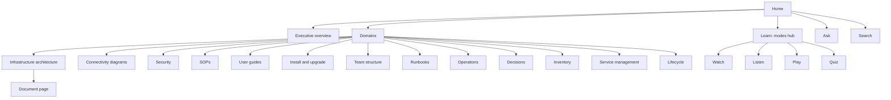

# 6. Site design

## Information architecture

Navigation principles:

- Domains are the primary structure. Modes are a second route into the same content.
- Search and Ask are reachable from every page.
- Every document page links to its available modes (F12).
- Navigation is built per tier (D-031). Colleagues see only `colleagues` pages. Infrastructure team members also see an "Infrastructure team" badge on restricted pages and a filter for them.
- A domain with no visible pages for the user is hidden.

## Routes

| Route | Content | Rendering |
| --- | --- | --- |
| `/` | Home | Static |
| `/exec` | Executive summary: tiles, system map, charts | Static, charts from `content/executive/metrics.yaml` |
| `/docs/[domain]` | Domain index | Static |
| `/docs/[domain]/[...slug]` | Document page | Static, from `generateStaticParams` |
| `/learn` | Modes hub | Static |
| `/learn/watch`, `/learn/listen` | Media libraries | Static |
| `/learn/quiz/[page-id]` | Quiz | Static data, client logic |
| `/learn/play` | Game | Static assets, client logic |
| `/ask` | Assistant | Client, calls API |
| `/search` | Search | Client, static index or server |
| `/api/ask` | Assistant API | Dynamic |
| `/api/search` | Search proxy (if server-side) | Dynamic |

## Document page anatomy

1. Title, domain, doc type, priority.
2. Trust bar: origin, reviewed by, reviewed on, last ingested, stale banner if past cadence.
3. Mode bar: Read (active), Listen, Watch, Quiz, Ask about this page. Unavailable modes are hidden or greyed with a reason.
4. Summary at the top (the first section for most doc types).
5. Body with in-page table of contents, built from headings.
6. Diagrams with their text description.
7. Related pages.
8. Lineage panel: sources, versions, change history.
9. Footer: owner, feedback link.

## Rendering pipeline

- Read Markdown and front matter at build time (`gray-matter`).
- Convert with `unified`, `remark` and `rehype`: GFM tables, heading anchors, code highlighting, Mermaid blocks passed to a client component.
- Extract headings for the table of contents.
- Compute the content hash for derived-asset checks.
- Lineage: front matter plus `git log` for the file.
- Broken internal links fail the build.

## Diagrams

- Mermaid rendered in the browser by a client component, loaded only on pages that have a diagram.
- Dark and light themes both supported.
- Each diagram is followed by its description text (N6).
- Large diagrams can be opened full-screen with pan and zoom. (Proposed)
- Fallback: if rendering fails in the browser, the Mermaid source shows in a code block. The build already rejects unparseable blocks.

## Executive views (F10)

Static pages built from content, not live data. The main view is the visual [executive summary](16-executive-summary.md) at `/exec`. The CIO sees every tier.

- Architecture at a glance: top-level C4 context, with drill-down links.
- Security baseline status: built from `security-baseline` pages and their control tables.
- Operations: key SOPs, runbooks and operations plans, and their review status.
- Teams: who owns each domain and service, from `team` pages and the `owner` field.
- Freshness: how current each domain is, from review dates.
- Each figure links to its source page. Executives can trace anything they see.

A "last reviewed" figure on an executive view reflects content review, not system health. The pages state this to avoid being mistaken for monitoring.

## Search experience

See [architecture](03-architecture.md) for engine choice.

- Search box in the header, keyboard shortcut to focus.
- Results show title, domain, snippet with highlight, doc type, and freshness.
- Filters: domain, doc type, audience.
- Results only include pages the user may see (S2).
- With a static index (Pagefind), build one index per scope set and let the proxy serve the right one. Otherwise use a server-side engine with a scope filter (D-007).
- Empty-state offers "Ask the assistant" with the query prefilled.

## Ask experience

- Chat panel as its own page and as a slide-over from any page.
- "Ask about this page" prefills context to that page and its related pages.
- Streaming answer, then a Sources list with links to the pages used.
- Suggested starter questions per audience.
- States: waiting (with queue position if busy), streaming, done, error, no-answer ("not found in the documentation").
- Feedback control on each answer (helpful, wrong, missing) feeding the evaluation set.
- A visible note that answers come from portal content and can be wrong.
- Details in [assistant and LLM](08-assistant-and-llm.md).

## Visual design

- Clean, technical, low-ornament. Dark mode supported.
- Typography sized for long reading. Line length capped.
- Colour never carries meaning alone. Status uses text and icons too.
- Diagram colours drawn from a palette that holds up in light and dark themes.
- A design token file in `site/` defines colours, spacing and type. (Proposed)

## Accessibility (N6)

- WCAG 2.2 AA is the target.
- Keyboard operable throughout, including chat, quiz and game.
- Visible focus. Skip links. Landmarks and heading order.
- Captions for video. Transcripts for video and audio.
- Respect `prefers-reduced-motion`; video and game do not autoplay.
- Quiz and game have non-timed modes.
- Chat answers announced politely to screen readers as they stream, without flooding.
- Automated checks in CI plus a manual test pass each phase.

## Performance (N3)

Proposed budgets, set against real measurements in Phase 1:

- Document page: largest contentful paint under 2.5 s on the corporate network on a mid-range laptop.
- JavaScript on a plain document page kept small. Mermaid, search UI, chat, quiz and game load lazily.
- Search index loaded on demand, not with the page.
- Images and media lazy-loaded, with size limits enforced in CI.

## Responsive behaviour

- Reading works on a phone (listen mode is the likely phone use).
- Sidebar collapses to a drawer. Table of contents becomes a dropdown.
- Wide tables scroll inside their own container.

## Authentication in the UI

- Unauthenticated requests redirect to the SSO provider.
- After sign-in the user's groups drive navigation, search and Ask. See [security](09-security-and-governance.md).
- A page the user lacks access to returns the same response as a missing page, so titles do not leak.

## Internationalisation

English only at launch (D-023). Strings are kept in one place so a second language is possible later.
