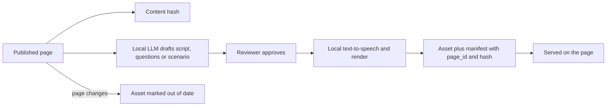

# 7. Learning modes

Seven ways to consume the same content: **Read, Search, Ask, Watch, Listen, Play, Quiz.**

Why several modes: different situations and different people call for different forms. The evidence does not support matching content to a person's "learning style". See [design considerations](12-design-considerations.md), DC-01. Modes are therefore offered by context and task, never assigned to a user.

## Common rules for all derived modes

- Source of truth is the published page. Every asset records `page_id` and `content_hash` (F11).
- AI drafts, a person reviews before an asset is published. Reviewers check facts against the page.
- An asset is marked **out of date** when its page changes.
- Every asset has a text equivalent (N6).
- Assets are served inside the network. Generation uses local models only (N1).
- Access scope of an asset equals the scope of its source page (S2).
- Each asset is optional. A page without assets is complete.

## Mode summary

| Mode | Best for | Source | Generated by | Review | Status |
| --- | --- | --- | --- | --- | --- |
| Read | Understanding the whole picture, reference | Page | n/a | Page review | Phase 1 |
| Search | Finding a known thing fast | Index of pages | CI | n/a | Phase 1 |
| Ask | Specific questions in plain language | Retrieved passages | Local LLM at request time | Evaluation set, feedback | Phase 2 |
| Listen | Learning away from a screen, commuting | Page summary | Script from LLM, local text-to-speech | Script review | Phase 3 |
| Watch | Seeing structure and flow | Page diagrams and summary | Script plus slide or diagram animation | Script and visual review | Phase 3 |
| Quiz | Checking and fixing understanding | Page | LLM drafts questions | Question review | Phase 3 |
| Play | Practising judgment in scenarios | Several pages | Scenario design plus LLM drafts | Scenario review | Phase 4 |

Phase numbers are Proposed. See the [roadmap](13-roadmap.md).

## Read

- The document page itself.
- Executive summary first. Detail below.
- Table of contents, diagrams, related pages, lineage.
- Reading level aimed at the audience in front matter. Executive pages avoid unexplained jargon. Admin pages assume VMware knowledge.

## Search

- Full-text, filtered by domain, type, audience.
- Scope-filtered results.
- Typo tolerance and synonym list for private-cloud terms (maintained in config).
- Search is the right answer when the user knows the term. Ask is the right answer when they know the question.

## Ask

- Local-LLM chat modelled on AskIO. Retrieval first, then a short grounded answer with source links.
- Answers only from portal content. Says so when it cannot find an answer.
- Full design in [assistant and LLM](08-assistant-and-llm.md).

## Listen

Purpose: a short audio explainer a person can play on a phone or at a desk.

- Format: a spoken summary of one page, or a short briefing on a domain. A two-voice conversational format ("podcast style") is possible. A single narrator is simpler and more accurate. Start with the single narrator. (Proposed, D-013)
- Length: target 3 to 8 minutes per page. (Proposed)
- Script: drafted by the local LLM from the page, constrained to its content, then reviewed by a person. Numbers, names and commands are read as written in the page.
- Voice: local text-to-speech. Engine is open (D-012). Pronunciation list for product and internal names.
- Not suitable for: step-by-step commands, long tables, code. Those are skipped and the audio points to the page.
- Delivery: audio file plus transcript on the page, and a feed per domain so people can use a podcast app inside the network. (Proposed)
- Disclosure: audio is labelled as AI-generated and reviewed.

## Watch

Purpose: short explainers that show structure and flow, especially architecture.

- Format: narrated walkthrough of diagrams and key points. Diagram-led, not talking-head.
- Length: target 2 to 5 minutes. (Proposed)
- Production: script from the page, narration from the same text-to-speech as Listen, visuals from the page's own Mermaid or SVG diagrams, animated in steps. Rendering by a scripted headless browser plus video encoder. (Proposed approach, D-014)
- Captions and transcript are required (N6).
- Not suitable for: procedures with exact commands. A screen recording of an actual procedure made by a person is better and can be linked as a manual asset.
- Review: a person watches it before publishing. A change to the source page marks the video out of date.
- Disclosure: labelled as AI-generated and reviewed.

## Quiz

Purpose: help people retrieve and apply what they read, and show gaps.

- Evidence: retrieving information strengthens later recall more than rereading. See DC-02.
- Format: multiple choice first (single and multiple answer), scenario questions for admins. Short answer later, with a model answer.
- Generation: the local LLM drafts questions from a page. Each question stores its `source_heading`, the correct answer, plausible distractors and an explanation that quotes the page.
- Review: a person checks each question for a single defensible answer. Poor distractors and trick questions are removed.
- Delivery: per-page quiz, domain quiz, mixed review. Retry allowed. Feedback after each answer, with a link to the supporting section.
- Spacing: a "review again" prompt resurfaces earlier questions. (Proposed)
- Privacy: scores are private to the user by default. Aggregate results show which topics people find hard, without names. Whether to store individual results at all is open (D-015).
- Tone: low stakes, light, no leaderboard by default. Not used for performance assessment.
- Scoring is plain. "Fun" comes from short length, instant feedback and varied formats, not gimmicks.

## Play

Purpose: practise judgment in realistic private-cloud situations without risk.

The game concepts below are **proposals** for discussion. None is decided (D-016).

| Concept | Idea | Learns |
| --- | --- | --- |
| Incident desk | Text scenario: an alert arrives, the player chooses diagnostic steps and gets consequences. Steps map to SOPs | SOP use, troubleshooting order |
| Change window | Sequence upgrade steps in the right order, with prerequisite traps | Install and upgrade procedures |
| Architecture builder | Place components on a canvas to meet requirements. Checked against the reference design | Reference architecture, dependencies |
| Security baseline hunt | Spot control gaps in a described configuration | Security baselines |

Design rules:

- Scenarios are authored from published pages and cite them. Each choice's outcome explains why, with a link.
- Scenarios are fictional systems. They do not expose real hostnames, addresses or credentials.
- No connection to live infrastructure (I5). It is a simulation of text and diagrams only.
- Start with the simplest concept, a branching text scenario. It needs no engine, only structured data and a small client component.
- Accessible: keyboard, screen reader, no time pressure by default.
- Treat Play as the highest-risk mode for scope creep. It ships last and only after Phase 3 usage shows demand.

## Choosing the mode: guidance on the site

- The home page and each document page present modes with a one-line description of when each helps.
- The site does not ask users to pick a style and does not remember a "preferred style".
- Usage data may show which modes are used for which tasks, in aggregate (Proposed, D-015).

## Generation pipeline for derived assets

CI runs the hash comparison on every build. A scheduled job offers regeneration for out-of-date assets, one at a time, off-hours, so Ask is not starved of CPU. (Proposed)

## Capacity note

CPU-only generation is slow. Audio and video generation compete with Ask for the same VM unless run on a separate instance or off-hours. Scripts are small. Text-to-speech is far lighter than chat inference. Video encoding is CPU-heavy but not model-bound. Capacity is validated in Phase 0 (see [risks](14-risks-and-open-decisions.md), R-06).
