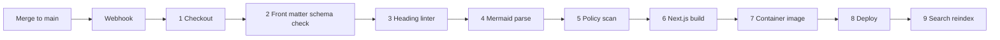

# 10. Deployment and CI/CD

## What CI/CD means (for VMware administrators)

- **Continuous integration (CI):** every change to the content or code is checked automatically before it is accepted. Checks are scripts that run on a build server. A failed check blocks the change.
- **Continuous delivery or deployment (CD):** after the checks pass, the system builds the site and deploys it with no manual steps.
- Analogy: a change request with automated pre-checks, where the "change" is a pull request and the "maintenance window" is a build that takes minutes.
- A **pipeline** is the ordered list of stages. A **runner** or **agent** is the machine that executes them. A **webhook** is an HTTP call from Git to the CI system saying "something merged".
- Common systems in large organizations: Jenkins, GitLab CI, GitHub Actions (including self-hosted runners), Azure DevOps Pipelines, TeamCity, Bamboo. The right choice is whichever the organization already runs (D-017).

## Environments

| Environment | Purpose | Content | LLM |
| --- | --- | --- | --- |
| Local | Authors and lab learners | Sample content | Optional small model |
| Dev | Integration of code changes | Sample content | Shared small instance |
| Production | Readers | Production content (internal repo) | Production LLM VM |

Production is deployed only from `main` of the internal repository. Dev can deploy from branches. (Proposed, I6)

## Build and deploy flow

## The nine stages

| # | Stage | Checks or does | Fails when |
| --- | --- | --- | --- |
| 1 | Checkout | Fetches code and `content/` at the merged commit | Repository unreachable |
| 2 | Front matter schema check | Validates every file against the JSON Schema; `domain` matches folder; `access_scope` known | Missing or invalid field |
| 3 | Heading linter | Required sections per `doc_type`, one H1, heading order, no skipped levels | Required section missing |
| 4 | Mermaid parse | Parses every diagram block | Syntax error |
| 5 | Policy scan | Secrets, sensitive patterns, disallowed links or HTML | Any hit |
| 6 | Next.js build | Static generation, broken-link check, accessibility lint | Build error, dead link |
| 7 | Container image | Builds the image, tags with commit hash, scans for vulnerabilities | Build failure, critical vulnerability |
| 8 | Deploy | Rolls the new image out; health check; automatic rollback on failure | Failed health check |
| 9 | Search reindex | Rebuilds search and vector indexes; checks asset manifests for out-of-date media | Index failure |

Stages 2 to 5 also run on every pull request, so authors and reviewers see failures before merge. Stages 6 to 9 run on merge. Item order and names follow the original addendum.

## Triggers

- Webhook on merge to `main` (N8).
- Nightly safety rebuild, which catches missed webhooks and picks up changes in shared config.
- Manual run by administrators.
- A schedule for the connectors is separate from the build (see [ingestion](05-ingestion-and-ai-conversion.md)).

## Hosting options

| Option | Fits when | Notes |
| --- | --- | --- |
| Docker Compose on one VM | Lab phase and small production | Simple. Single point of failure; mitigated by rebuilding from Git (I7) |
| On-premises Kubernetes | The organization already runs a cluster | Rolling updates, scaling Ask gateway; adds operating cost |
| Static files on an internal web server plus a small API service | Lowest footprint | Needs the proxy to enforce auth and scopes |

Start with Docker Compose. Move if scale or policy requires (D-018).

## Components on the web VM (Compose)

| Service | Role |
| --- | --- |
| Reverse proxy | TLS, SSO enforcement, scope checks, rate limits |
| Web | Next.js server |
| Search | Pagefind files or Meilisearch or Typesense |
| Vector index | Part of the search engine or a small separate store |
| Metrics and logs agent | Ships to the organization's monitoring |

The LLM runs on its own VM (see [assistant](08-assistant-and-llm.md)) so a model restart or heavy request does not affect page serving.

## Network

- Browser to reverse proxy over HTTPS on the internal network.
- Web VM to LLM VM on one port. Firewall rules allow only that path.
- LLM VM has no outbound internet.
- Connectors reach source systems through approved paths.
- No path to vCenter or management networks (I5).

## TLS and DNS

- Internal certificate authority issues the certificate.
- Internal DNS name for the portal. (Name is a choice for the organization.)

## Sizing the web tier (Proposed starting points)

| VM | vCPU | RAM | Disk |
| --- | --- | --- | --- |
| Web and search | 4 | 16 GB | 100 GB |
| LLM | 16 | 128 GB | 200 GB (model files, indexes) |
| Pipeline runner | 4 | 16 GB | 200 GB (staging) |

Disk for the LLM VM depends on how many model files are kept. Tune after Phase 0.

## Backup and recovery

- Content: Git is the backup. Mirror the repository per the organization's policy.
- Rebuild: production can be recreated from Git plus configuration and secrets (I7).
- Index: rebuilt, not backed up.
- Chat logs and feedback: included in standard backup.
- Model files: kept in an internal artifact store with checksums.
- Recovery test once per phase: rebuild from scratch in dev.

## Monitoring (N9)

| Area | Signals |
| --- | --- |
| Site | Availability, response time, error rate |
| Pipeline | Run success, items quarantined, queue depth, age of oldest queued item |
| CI | Build duration, failure rate by stage |
| LLM | Time to first token, tokens per second, queue length, memory, restarts |
| Content | Pages past review cadence, out-of-date media, dead links |

Alerts go to the platform owners.

## Release and rollback

- Container images are immutable and tagged with the commit.
- Rollback is a redeploy of the previous tag.
- Prompt and model changes follow the same path, with the evaluation result attached.

## Lab use (T1)

Each stage can be run locally. The repository ships one command per check so learners can see a failure before the pipeline does. The lab exercises are in the [roadmap](13-roadmap.md).
