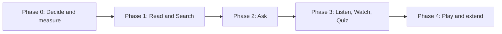

# 13. Roadmap

Phases are Proposed. No dates are set. Durations depend on team size, which is not yet known (D-025). Each phase has exit criteria. No code starts before Phase 0 decisions are made.

## Phase 0. Decide and measure

Goal: remove the largest unknowns.

Work:
- Confirm open decisions that block design (D-001, D-002, D-004, D-005, D-017, D-020, D-025, D-026, D-027).
- Stand up the LLM VM on the target host. Check CPU features. Record `lscpu` output.
- Run the model bake-off ([assistant](08-assistant-and-llm.md)). Measure first-token time, tokens per second, memory, concurrency.
- Collect 20 sample sources and write target pages by hand (gold set).
- Draft the first evaluation set with real admin questions.
- Choose the CI system and the IdP integration path.
- Confirm the repository model for production content.
- Review the hosted-site reference (isvara.io) for features worth copying. Record what was learned about its retrieval approach.

Exit criteria:
- A model and quantisation selected with measured numbers, or a documented decision to resize.
- Decisions listed above recorded.
- Gold set and evaluation set exist.
- Data owner approves the first source.

## Phase 1. Read and Search

Goal: a trustworthy portal with content, before any AI features.

Work:
- Repository, schema, linters, CI stages 1 to 9 without the assistant.
- Next.js site: home, domains, document pages, lineage, table of contents, Mermaid, executive overview.
- SSO, scope enforcement, search with scope filtering.
- Pagefind or a server search, chosen in Phase 0.
- One connector (likely Confluence) and the conversion pipeline with human review.
- Initial content for two domains.
- Accessibility and performance baselines.
- Observability.

Exit criteria:
- Authorized users read and search; unauthorized users cannot see restricted pages in any surface (scope matrix test passes).
- Pipeline creates reviewable pull requests from real Confluence pages.
- Policy scan blocks seeded secrets.
- Performance and accessibility budgets met on sample pages.
- Recovery test passed.

## Phase 2. Ask

Goal: the local assistant.

Work:
- Retrieval index with scope filtering.
- `/api/ask`, streaming UI, sources, feedback.
- Prompt, evaluation harness, injection and scope-leak tests.
- Load test at 2 to 3 users.
- Logging and retention.

Exit criteria:
- Evaluation set meets thresholds set from the Phase 0 baseline.
- Zero scope leaks.
- First token within 20 s at expected concurrency (N5), or a documented resize decision.
- Users can report wrong answers.

## Phase 3. Listen, Watch, Quiz

Goal: add derived modes for the pages that matter most.

Work:
- Manifest system and out-of-date detection.
- Quiz generation, review tool, quiz UI.
- Text-to-speech selection; audio generation; transcripts; feed.
- Video generation from diagrams; captions.
- Remaining connectors (email, transcripts, Office).

Exit criteria:
- Every published asset reviewed, captioned or transcribed, labelled and linked to its page version.
- Out-of-date marking works on a page change.
- A sample of users completes find-the-answer and quiz tasks. Feedback collected.

## Phase 4. Play and extend

Goal: scenario-based practice and refinement.

Work:
- Choose one game concept with users; build the branching scenario engine; author scenarios from SOP and install pages.
- Executive view refinements.
- Scale the LLM tier if usage requires.
- Second language if needed.

Exit criteria:
- Scenarios are reviewed by domain experts.
- Game accessible by keyboard and screen reader.
- Usage supports continuing the investment.

## Hands-on lab track (T1)

Exercises mapped to phases. Participants are VMware administrators.

| Phase | Exercise |
| --- | --- |
| 0 | Install llama.cpp in a VM; read `lscpu`; measure tokens per second |
| 1 | Write a front matter validation rule; break and fix a page; open a pull request |
| 1 | Add a Mermaid diagram and see CI parse it |
| 2 | Add a question to the evaluation set; observe a regression |
| 3 | Review an AI-drafted quiz; fix a bad distractor |
| 4 | Author a branching scenario from an SOP |

Tools: VS Code, Claude Code, Cursor, GitHub, as in the original strategy.

## Dependencies

- IdP and group data (Phase 1).
- LLM VM on suitable hardware (Phase 0).
- Source system access and data-owner approval (Phase 1 onward).
- Reviewer capacity (all phases).
- CI system and runners (Phase 1).

## What is deliberately out of scope for now

- GPU hosts, fine-tuning, custom model training.
- Live telemetry or monitoring.
- External access.
- Multi-language content.
