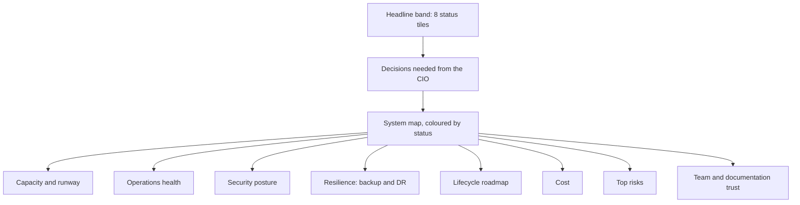
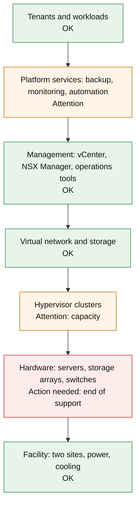
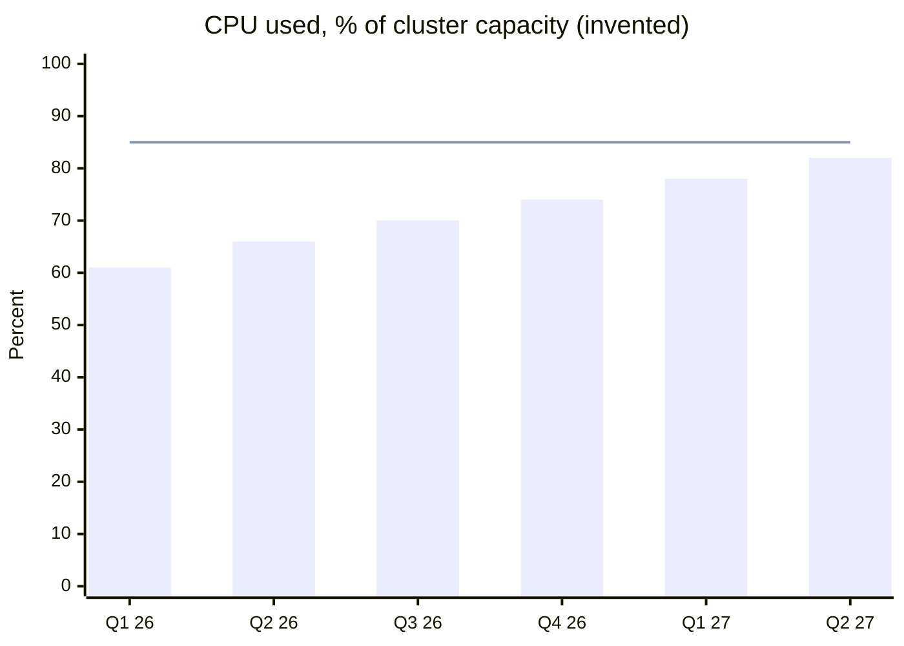
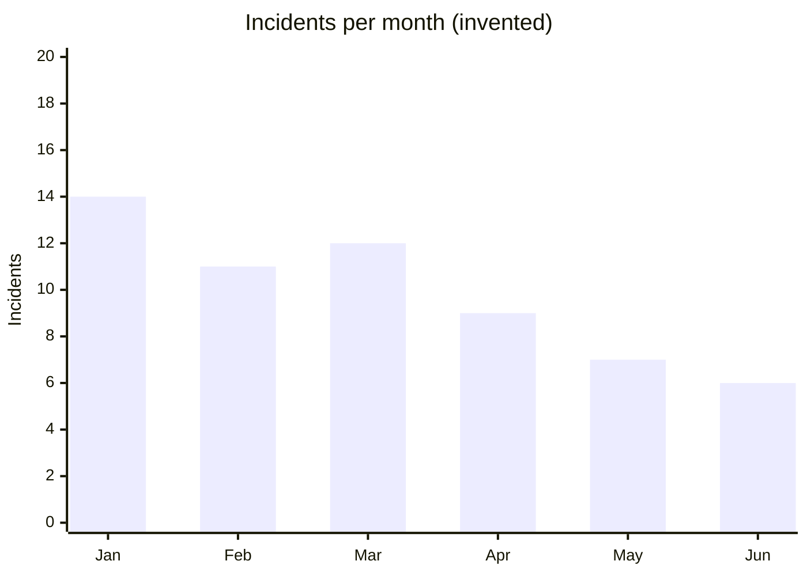
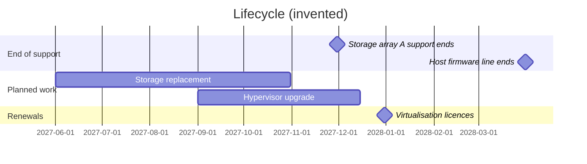
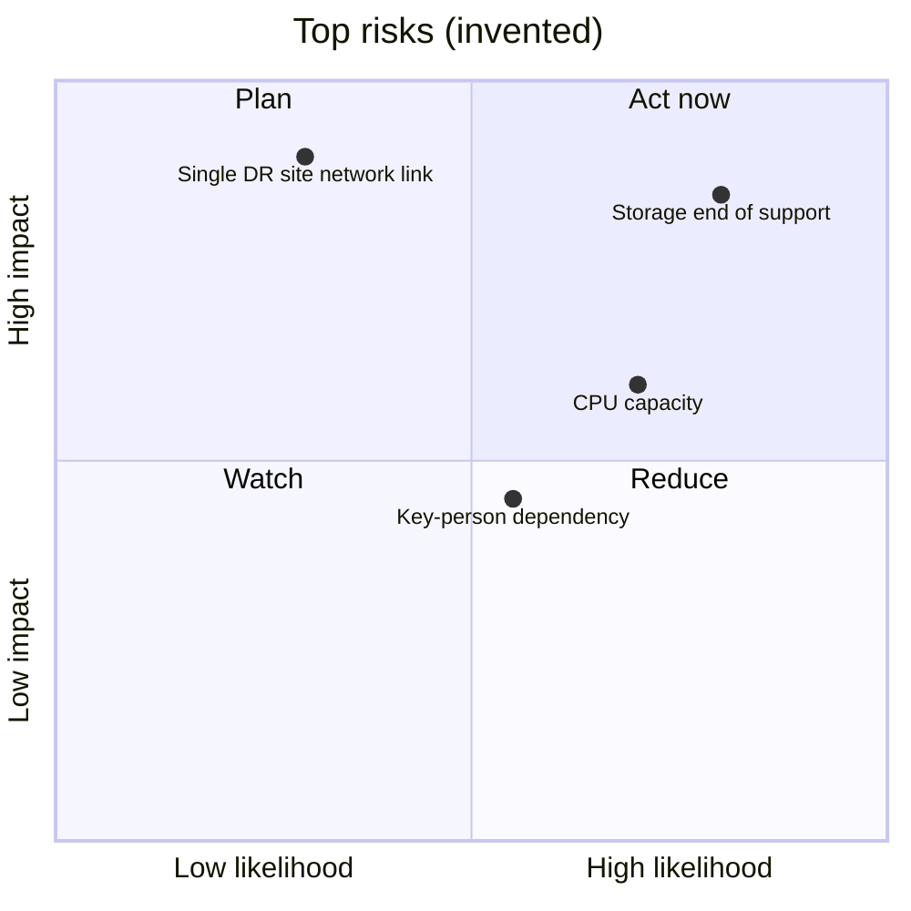

# 16. Executive summary

A visual, one-screen view of the whole private cloud for the CIO and IT leadership. Route `/exec`. It implements F10 and F14.

All figures, names and dates in this document are invented. They show the shape of the page, not real values.

## Reader and job

- Reader: the CIO and leadership delegates.
- Job: in five minutes, know whether the private cloud is healthy, safe, resilient, affordable and ready for what comes next. Know what decision is needed.
- The CIO sees every tier, including `infra-team` (D-031). The summary draws on all pages.

## Principles

- **Visual first.** Every section leads with a chart, map or tile. Text explains, it does not carry the message.
- **One screen, then drill down.** The headline band fits one screen. Each section opens to detail. Each figure links to the page or register it comes from.
- **Status in words and icons, not colour alone.** "OK", "Attention", "Action needed", with an icon and a colour (N6).
- **As-of dates everywhere.** Each figure shows its reporting period and source. The portal has no live connection to vCenter (I5). This is a reporting snapshot, not monitoring. The page says so.
- **Trend over point.** A number shows its direction against last period.
- **Decisions asked of the CIO are explicit.** A short list at the top, each with an owner and a due date.
- **Every visual has a text alternative.** A one-line summary under it and a data table behind a "Show data" toggle.

## Page layout



The page opens with status tiles and the CIO's decisions. The system map follows. Each themed section below it can be opened for detail.

## Sections

| # | Section | Visual | Shows | Data from |
| --- | --- | --- | --- | --- |
| 1 | Headline band | Status tiles with trend arrow and sparkline | Availability, capacity headroom, baseline compliance, open high risks, DR test status, upcoming end of support, change success rate, documentation freshness | `content/executive/metrics.yaml` |
| 2 | Decisions needed | Short list with owner and due date | What leadership must decide, approve or fund | `decisions/` pages marked `needs_cio: true` (Proposed) |
| 3 | System map | Layered diagram, facility to tenants, each block with a status word | The whole machine on one picture. Click a block to drill down | `infrastructure-architecture/` system map |
| 4 | Capacity and runway | Bar per cluster (used vs headroom) and a forecast line with the runway date | When CPU, memory or storage runs out at current growth | Capacity plan, `operations/` |
| 5 | Operations health | Monthly bars by severity, change success line, time-to-restore trend | Is operations getting better or worse | Monthly operations report |
| 6 | Security posture | Stacked bar per framework (met, partial, gap), exceptions count, vulnerability ageing | Compliance and open exposure | `security/` baseline pages |
| 7 | Resilience | Target vs tested RTO and RPO per tier, last restore test result | Can we recover, and was it proven | `operations/` DR and backup plans |
| 8 | Lifecycle roadmap | Gantt of end-of-support dates, upgrades, refresh, licence renewals | What is coming and what it needs | `lifecycle/` registers |
| 9 | Cost | Spend by category, cost per VM trend | Where money goes, and unit cost over time | `lifecycle/` cost model |
| 10 | Top risks | Likelihood by impact quadrant | The few risks that matter, with owners | Risk register |
| 11 | Team and documentation trust | On-call coverage, skills gaps, freshness per domain | Can the team run it, and is the documentation current | `team-structure/`, page review dates |

## Examples

Invented values. Mermaid can draw most of these. Gauges, tiles and sparklines need a chart component (D-032).

### Status tiles

| Tile | Value | Trend | Status |
| --- | --- | --- | --- |
| Availability (quarter) | 99.95 % | ▲ from 99.91 % | ✅ OK |
| CPU headroom | 22 % | ▼ from 27 % | ⚠️ Attention |
| Baseline compliance | 91 % | ▲ from 88 % | ✅ OK |
| Open high risks | 3 | ▬ unchanged | ⚠️ Attention |
| Last DR test | Passed, 2027-03 | | ✅ OK |
| Next end of support | 7 months | | ⛔ Action needed |
| Change success rate | 97 % | ▲ from 95 % | ✅ OK |
| Pages within review date | 84 % | ▼ from 90 % | ⚠️ Attention |

On the site these are tiles with icons and sparklines. The table is the text alternative.

### System map



Seven layers from facility to tenants. Hardware needs action because of end of support. Hypervisor capacity and platform services need attention.

### Capacity runway



CPU use rises about 4 points a quarter. It crosses the 85 % threshold within two quarters.

### Operations health



Incidents fell from 14 to 6 a month over six months.

### Lifecycle roadmap



Storage array A loses support in November. Its replacement is planned to finish a month earlier.

### Top risks



Two risks sit in "Act now": storage end of support and CPU capacity.

## Metrics register

Figures come from one file, not from page prose. CI builds the charts from it.

```yaml
# content/executive/metrics.yaml (invented example)
access_scope: infra-team
period: 2027-Q2
as_of: 2027-07-05
reviewed_by: infra-lead
metrics:
  - id: availability
    label: Availability (quarter)
    value: 99.95
    unit: "%"
    previous: 99.91
    thresholds: { ok: 99.9, attention: 99.5 }
    source: operations/monthly-report-2027-06
  - id: cpu_headroom
    label: CPU headroom
    value: 22
    unit: "%"
    previous: 27
    thresholds: { ok: 25, attention: 15 }
    source: operations/capacity-plan
```

- Each metric names its source page. The tile links to it.
- Thresholds set the status word. Higher-is-better or lower-is-better is per metric (Proposed).
- The infrastructure team lead reviews the file each period. The pull request is the sign-off.
- A metric past its period shows "Not updated" instead of a status.

## Other ways to consume it

- **Print and PDF.** A print stylesheet gives a two-page board pack with the same visuals.
- **Listen.** A three-minute audio briefing generated from the summary text (F7).
- **Watch.** A two-minute narrated walk through the system map (F6).
- **Ask.** "Why is hardware red?" answers from the linked pages, with sources.

## Who sees what

| Reader | Sees |
| --- | --- |
| CIO and leadership | Everything, all tiers |
| Infrastructure team | Everything |
| Colleagues | A colleague version: tiles and sections built only from `colleagues` pages. Restricted sections are left out, not blurred (Proposed) |

## Cadence and ownership

- Updated monthly, or after a major incident.
- Owner: infrastructure team lead. Reviewer: a second team member.
- The CIO's decision list is refreshed before each leadership meeting.

## Related

- [Site design](06-site-design.md#executive-views-f10): route and page anatomy.
- [Documentation set](15-documentation-set.md): the pages the figures come from.
- [Security and governance](09-security-and-governance.md#audience-tiers): tiers and leadership access.
